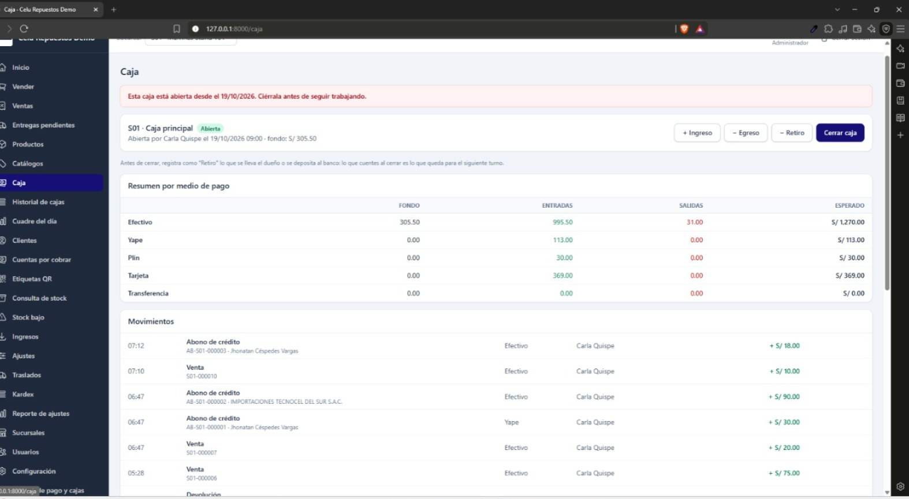
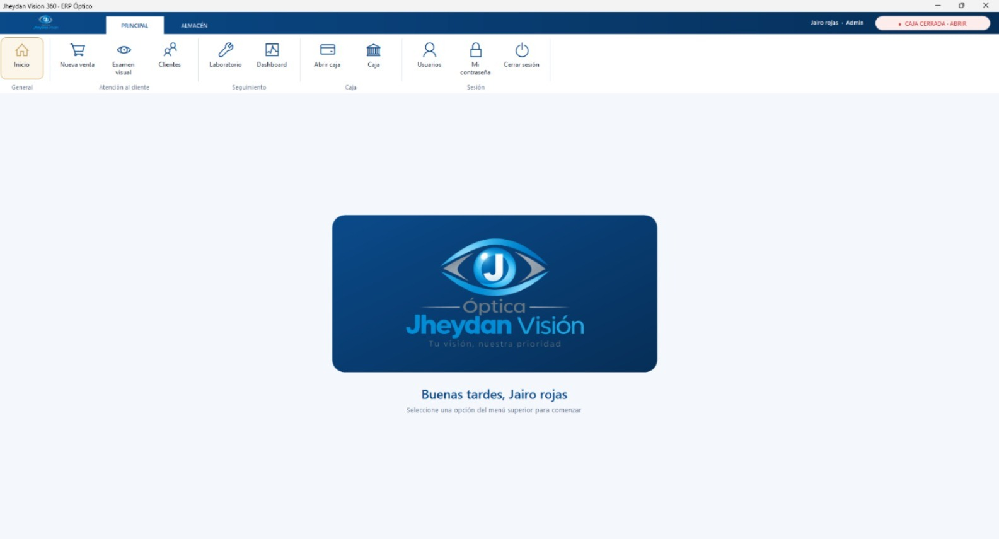
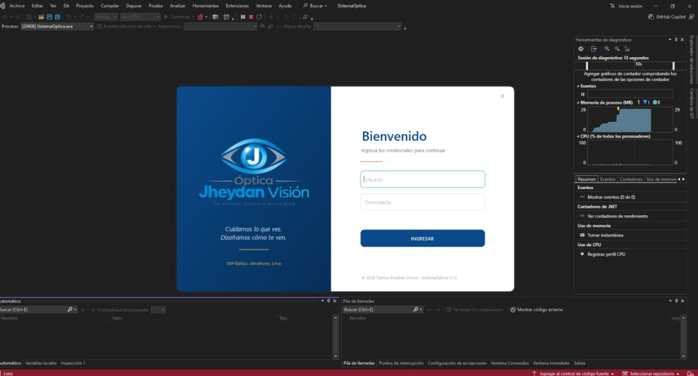
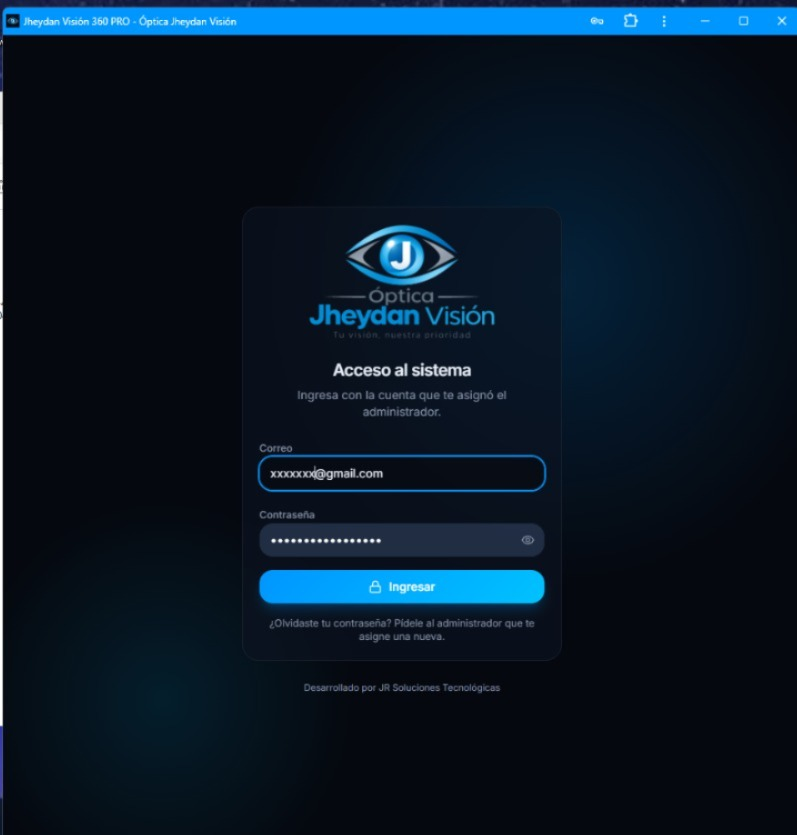
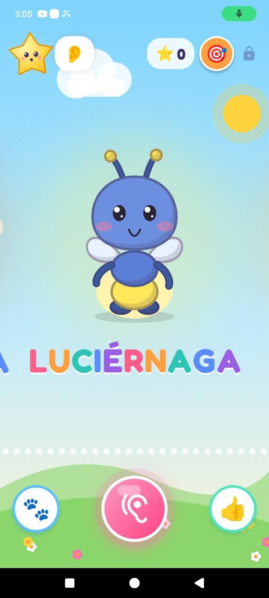
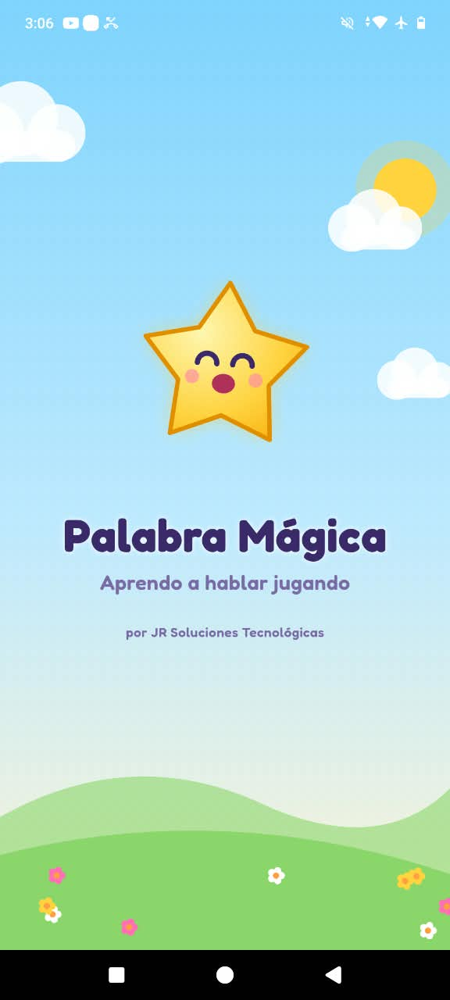
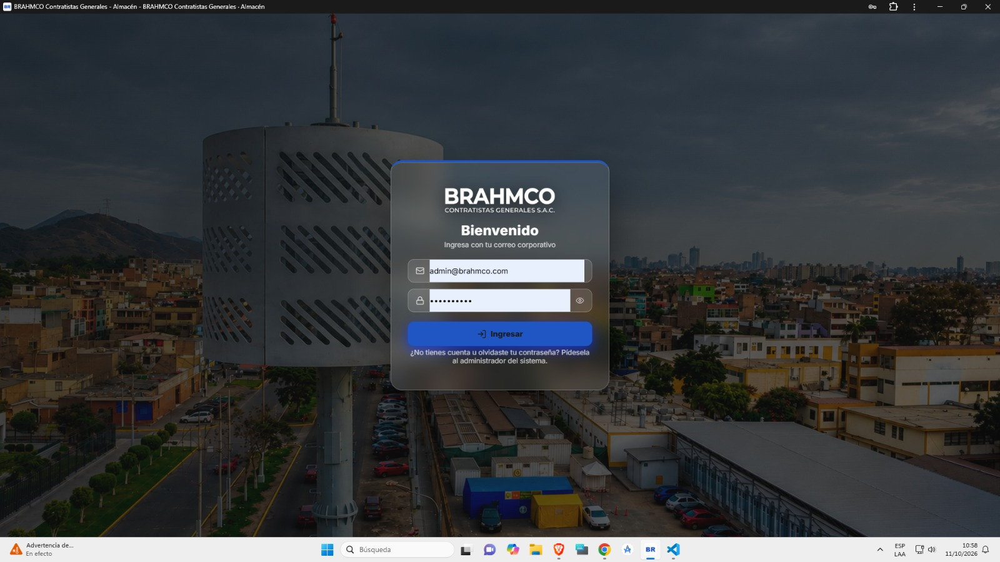
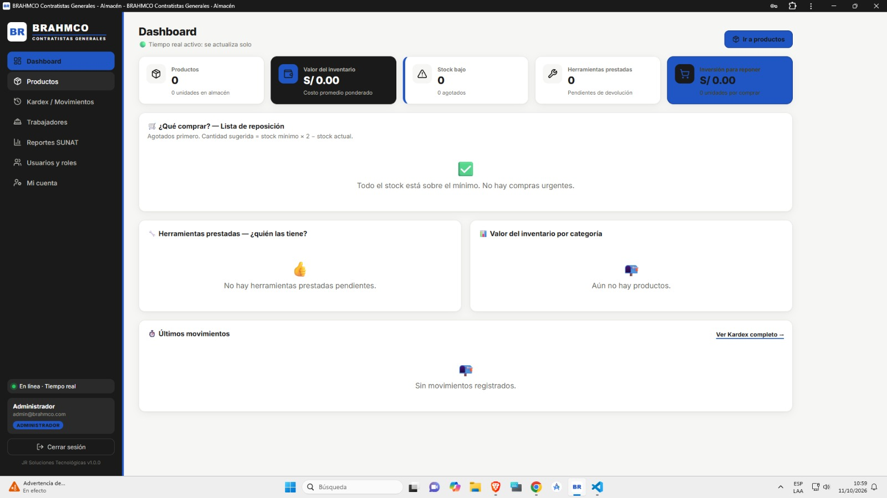

# Hola, soy Jairo Rojas 👋

Desarrollador de software en formación, estudiante de Sistemas en SISE (Lima, Perú).
Desarrollo sistemas a medida para negocios: ventas, inventario, gestión y aplicaciones móviles.

Antes de programar trabajé más de 10 años como **maestro de obra**, dirigiendo equipos y entregando proyectos a tiempo. Ahora aplico esa misma disciplina al software.

---

## 🛠️ Tecnologías

---

## 🤖 Cómo trabajo

Desarrollo con apoyo de **inteligencia artificial** (Claude y Claude Code) como herramienta principal de trabajo.
Yo defino los requisitos con el cliente, planifico el sistema, reviso y pruebo el código, y la IA me ayuda a construirlo más rápido.
Mis proyectos más recientes fueron hechos de esta forma, y sigo aprendiendo cada día a programar mejor por mi cuenta.

---

## 🚀 Proyectos

> Los proyectos comerciales tienen código privado. Aquí muestro qué hacen y con qué están construidos.

### 🏪 Sistema de ventas con QR (en desarrollo)
Sistema web de ventas e inventario para negocios con **varias sucursales**. Usa lectura de **códigos QR** en lugar de código de barras, e incluye control de stock por sucursal y gestión de clientes (CRM).
**Tecnologías:** Next.js · TypeScript · Supabase

### 👓 ERP Óptico
Sistema de escritorio para ópticas: registro de clientes y medidas, ventas e inventario.
**Tecnologías:** C# · .NET · SQL Server

### 🧸 Palabras Mágicas (próximamente en Google Play)
App educativa para niños de 1 a 3 años que los ayuda a decir sus primeras palabras con personajes animados.

### 🔧 Sistema de gestión para taller
Sistema a medida para la gestión de un taller de metalmecánica.

### ⚛️ Proyectos de práctica
- [mi-primer-react](https://github.com/jairotomasrojasquispe-droid/mi-primer-react): mi primer proyecto con React.

---

## 📫 Contacto

- 📧 jairotomas.rojasquispe@gmail.com
- 📱 WhatsApp: 908 504 489
